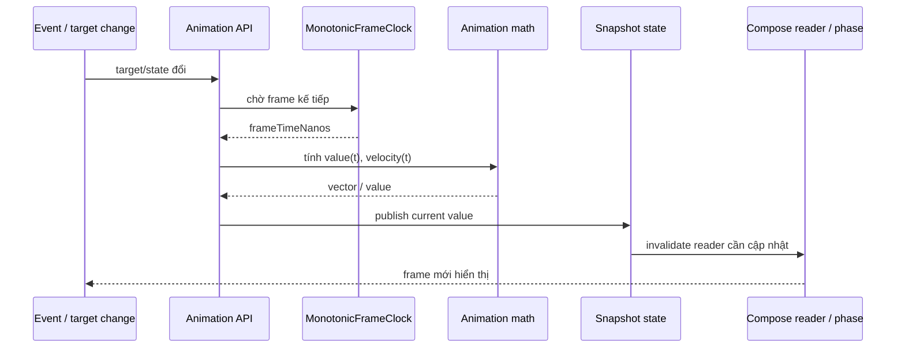

# Compose Animation — ghi chú cơ chế

## Mô hình cốt lõi

Một animation được hiểu tốt nhất là **giá trị thay đổi theo thời gian từ current state tới target state**, được lấy mẫu theo frame và công bố cho UI. API animation quyết định ai giữ state/điều khiển; `AnimationSpec` quyết định nội suy/động lực học; converter đưa kiểu dữ liệu về vector; Compose xử lý state read theo phase.



Đây là mô hình, không phải cam kết rằng mọi API chạy chính xác cùng coroutine/source path hoặc mọi frame chạy mọi phase. Lịch frame không cố định 16.6 ms; dùng frame time thật và đánh dấu các con số 60/120 Hz là ví dụ.

## Chọn API theo quyền điều khiển

| Trường hợp | API để học đầu tiên | Điểm cần quan sát |
|---|---|---|
| Một property đi tới target khi state đổi | `animate*AsState` | Dễ dùng; value là state; không giành quyền sở hữu animation lifecycle thủ công |
| Nhiều property cùng phụ thuộc một state machine | `updateTransition` / `Transition` | Nhiều child animation dùng chung target và transition lifecycle |
| Hiện/ẩn hoặc chuyển content | `AnimatedVisibility`, `AnimatedContent`, `Crossfade` | Enter/exit, content identity, lúc content được remove |
| Thay đổi size/layout | `animateContentSize`, layout animation APIs | Modifier order, measurement/layout cost, constraint behavior |
| Gesture, drag, fling, tuần tự hóa | `Animatable` + coroutine | `snapTo`, `animateTo`, `animateDecay`, bounds, cancellation/mutual exclusion |
| Custom animation math | `Animation`, `TargetBasedAnimation`, `DecayAnimation`, `TwoWayConverter` | Nắm vector/time/spec; internal APIs cần version label |

## Toán và thời gian

- `AnimationSpec<T>` mô tả cách current đi tới target; runtime thường làm việc với vectorized spec và play time.
- `tween` gắn vào duration/easing; keyframes mô tả mốc thời gian; `snap` nhảy tức thì; spring mô tả phản ứng theo damping/stiffness; decay dùng vận tốc đầu và friction để giảm tốc.
- `TwoWayConverter<T, V>` đưa kiểu domain sang vector và đổi ngược. `AnimationVector` là kiểu vector có số chiều không giới hạn ở 1–4.
- `Color.VectorConverter` trong source đã đối chiếu chuyển qua Oklab và dùng `AnimationVector4D`; đây là chi tiết implementation của source revision, không phải quy tắc mọi phiên bản hay tự động biến mọi thao tác màu thành Oklab.
- Spring/tween đều có thể nhận target mới qua API cấp cao; câu hỏi đúng là current value/velocity tiếp tục thế nào với spec/API đang dùng. Spring tự nhiên mang velocity; duration/easing-based tween thường không bảo toàn cảm giác vận tốc theo cùng semantics. Không mô tả tween là “không thể bị ngắt”.
- Animation chạy theo frame time; sau jank giá trị có thể nhảy tới sampling time hiện tại. Đừng xây engine/quiz đếm frame rồi giả định tất cả frame dài bằng nhau.

## Animatable và gesture

`Animatable` giữ một current value và cung cấp suspend operations. Một animation mới có thể hủy/cắt thao tác đang chạy theo mutation priority/mutex semantics. `animateTo` chạy tới target; `snapTo` gán giá trị để bám gesture; `animateDecay` dùng velocity để giảm tốc; bounds/finished listener có vai trò riêng. Học cancellation và animation như một chuỗi coroutine, không mô tả như animation thread độc lập.

Trong drag: cập nhật vị trí bám tay; đo velocity; khi nhả tay bàn giao velocity cho decay/spring. `animate*AsState` phù hợp cho thay đổi target declarative thông thường, không phải công cụ duy nhất cho điều khiển 1:1.

## State read và render phases

Compose theo dõi state read. Đọc animation state trong body composable có thể invalidate composition; đọc trong lambda modifier thích hợp có thể dời work sang placement hoặc draw. `graphicsLayer {}` có thể giúp defer các thuộc tính layer; nó không có nghĩa “không còn work”, “luôn chỉ chạy GPU”, hoặc mọi property loại bỏ layout. Chọn modifier theo semantics của property và đo bằng trace/benchmark khi cần.

Ví dụ chẩn đoán:

```kotlin
val x by animateFloatAsState(targetValue = targetX, label = "x")
Box(Modifier.offset { IntOffset(x.roundToInt(), 0) })
```

Lời lambda làm thời điểm đọc khác với overload nhận value trực tiếp. Dạy người học xác định “đọc ở composition hay placement?” trước khi kết luận số phase sẽ chạy.

## Lookahead và shared elements

- `LookaheadScope` cho layout trong scope xác định đích qua lookahead pass, rồi approach pass tiến dần tới đích. Không gọi nó là một lượt đo “nhẹ” bắt buộc mỗi frame.
- `SharedTransitionLayout` cung cấp `SharedTransitionScope`; `Modifier.sharedElement`/`sharedBounds` match bằng key và cần visibility/animated content scope phù hợp.
- Modifier order, clipping/overlay, unmatched key, cùng lúc có nhiều state target là các điểm debug chính.

## Accessibility, lifecycle và test

- Chuyển động phải có mục đích, không cản nội dung/gesture; kiểm tra reduced motion/setting và trạng thái cuối vẫn đọc được.
- Nếu composable rời composition, effect coroutine có thể bị hủy. Với lazy item, item rời/đi vào viewport có thể tạo lại lifecycle nếu state không được hoist.
- Dùng Compose animation clock trong UI tests để điều khiển thời gian và khẳng định start/mid/end state; tránh test bằng `delay`/wall-clock khi có thể dùng clock test.

## Sai lầm trong prompt tham khảo cần tránh

- Không tuyên bố `animateColorAsState + Modifier.background` luôn bắt buộc cả composition, layout và draw. State read location và modifier implementation xác định invalidation; layout có thể không đổi.
- Không coi `graphicsLayer` là GPU-only hoặc hứa `Composition=0, Layout=0` cho tất cả trường hợp; chỉ nói phase nào có thể được bỏ qua theo cách dùng và verify bằng tooling.
- Không nói spring “mới hỗ trợ interruption”; đổi target có thể xảy ra với nhiều API. Dạy cách value/velocity/animation spec được tiếp tục.
- Không hard-code “mỗi frame 16.6ms” hoặc “đúng 60/120 lần giây”.
- Không mô phỏng `Oklab`, `MutatorMutex`, `Choreographer` hoặc RenderNode như thể simulator TypeScript đang chạy Android source.

## Sách Compose/animation trong kho

- *Android Animations by Tutorials*, PDF 211 trang: Ch.1–9 là View/Activity/RecyclerView animation để hiểu lịch sử/đối chiếu; Ch.10 “Jetpack Compose Animations” bắt đầu PDF p.193, gồm visibility p.196, size p.199, state p.204.
- *Jetpack Compose by Tutorials*, 2nd ed., PDF 441 trang: Ch.12 “Animating Properties Using Compose” bắt đầu p.324, `Transition` p.332, content p.337.
- *Android UI Development with Jetpack Compose*, PDF 248 trang: Ch.8 animation bắt đầu p.166.
- *Jetpack Compose 1.3 Essentials*, PDF/EPUB: dùng như nguồn ví dụ theo phiên bản 1.3, không coi là API hiện hành.

## Nguồn chính thức

- [Quick guide to Animations in Compose](https://developer.android.com/develop/ui/compose/animation/quick-guide).
- [Value-based animations](https://developer.android.com/develop/ui/compose/animation/value-based) — `Animatable`, transitions, specs.
- [Shared element transitions](https://developer.android.com/develop/ui/compose/animation/shared-elements), [LookaheadScope API](https://developer.android.com/reference/kotlin/androidx/compose/ui/layout/LookaheadScope).
- [Compose phases](https://developer.android.com/develop/ui/compose/phases), [performance](https://developer.android.com/develop/ui/compose/performance/phases), [side effects](https://developer.android.com/develop/ui/compose/side-effects).
- [AndroidX `ColorVectorConverter.kt`](https://android.googlesource.com/platform/frameworks/support/+/androidx-main/compose/animation/animation/src/commonMain/kotlin/androidx/compose/animation/ColorVectorConverter.kt) — source detail; pin a commit/version before using in a versioned lesson.
- Source modules: `compose/animation/animation-core` (`Animatable`, `SuspendAnimation`, vectorized specs, spring/decay) and `compose/animation/animation` (high-level composables).
