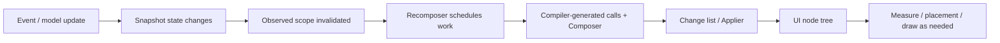

# Compose Runtime — ghi chú cơ chế

## Mô hình cốt lõi

Compose là một hệ thống khai báo và incremental. Composable code mô tả UI từ input/state; runtime theo dõi phần phụ thuộc vào state, tính lại scope cần thiết và áp dụng thay đổi qua Applier. Recomposition không đồng nghĩa dựng lại toàn bộ cây, và Compose Runtime không tự làm mọi việc vẽ pixel của platform.

Sơ đồ là đường giảng khái niệm; runtime có nhiều đường kích hoạt và tối ưu khác. Snapshot apply/observer timing và Android frame scheduling cần gắn với version khi mô phỏng cụ thể.

## Vai trò các thành phần

| Thành phần | Vai trò hữu ích để hiểu | Lưu ý |
|---|---|---|
| Compose compiler plugin | Biến đổi composable calls để runtime nhận composer/groups/parameter-change information và restart/skip scopes | Không xem Kotlin source giả lập là bytecode chính xác; compiler/version đổi |
| `Composition` | Quản lý một lần dựng/cập nhật composition tree, kết nối Composer với Applier/parent context | Không mặc định mỗi `setContent` nhất định tạo Composition mới; host/lifecycle/strategy quyết định |
| `Composer` | API runtime mà compiler-generated code nhắm tới; theo dõi vị trí, slots, changes và skipping | Android docs nói direct calls nên tránh; `currentComposer` là internal, không dùng trong app |
| SlotTable | Biểu diễn nhóm/slot positional để lưu trạng thái composition và thông tin phục vụ so sánh/memoization | Tách khỏi LayoutNode/render tree. Tài liệu design cảnh báo chi tiết cấu trúc có thể cũ/thay đổi |
| `Snapshot`/`MutableState` | Quản lý giá trị observable và những lần đọc/ghi; snapshot cho phép isolation/apply; observer ghi nhận dependencies | State holder không tự chọn scope UI; nơi đọc state quyết định reader nào invalidated |
| `Recomposer` | Điều phối recomposition/apply work khi có invalidation và frame/runtime scheduling | Không chỉ “chạy khi Snapshot đổi”, không phải renderer, không nhất thiết chạy đúng một lần/frame |
| `Applier<N>` | Áp dụng tree operations do composition phát ra lên node tree loại `N` | Generic; Android UI là một host, không phải định nghĩa duy nhất của Compose |
| Android host/View | Cung cấp kết nối window, lifecycle, owner services, input, semantics bridge, measure/draw | Internal host details khác platform/version; semantics tree liên quan accessibility/testing nhưng không chỉ qua một “Owner” |

## Đọc đường đi của một state update

1. Một event thay đổi state observable (ví dụ `MutableState.value`). Nếu policy cho rằng giá trị có thay đổi, state system ghi nhận mutation.
2. Snapshot rules xác định khi nào các thay đổi được nhìn thấy và observer được báo. Mutable snapshot có thể cô lập thay đổi đến lúc apply.
3. Composition/layout/draw readers đã đăng ký state read; hệ thống invalidate đúng reader/scope liên quan.
4. Recomposer xử lý work. Compiler-generated composable calls chạy với Composer; scope có thể restart, parameter checks có thể cho phép skip phần ổn định.
5. Nếu composition tạo thay đổi cấu trúc/node/property cần áp dụng, Applier cập nhật tree tương ứng.
6. Layout/draw chạy nếu input phase thay đổi; các phase có thể bỏ qua phần không cần thiết. State read trong composition, measure/placement hay draw có thể dẫn đến đường cập nhật khác nhau.

`Snapshot.apply` không có nghĩa “ngay tại lệnh set là vẽ xong”. Hãy dạy riêng mutation, apply/observer notification, invalidation, recomposition, apply changes, layout và draw; gộp thành một mũi tên duy nhất sẽ che mất điểm gây lỗi.

## Composer, group identity và skipping

- Runtime cần nhận biết vị trí call trong cấu trúc composition; vị trí tham gia vào positional memoization (như `remember`).
- `key()` và stable identity có ý nghĩa ở các list/branch thay đổi cấu trúc; thiếu key có thể gắn state/effect cũ với item mới khi thứ tự đổi.
- Compiler-generated code có thể lưu/tham chiếu parameter values để kiểm tra có thể skip hay không. Stability/strong skipping phụ thuộc Kotlin/Compose compiler version.
- `changed()`, `startGroup`, `$changed`, group key và slot cursor là chi tiết compiler/runtime; không gọi hoặc tự viết như API ứng dụng.
- Một composable có thể được gọi nhiều lần và mỗi call là một instance/lifecycle riêng trong Composition.

## Bugs nên học bằng timeline

| Triệu chứng | Câu hỏi cơ chế | Hướng chẩn đoán |
|---|---|---|
| UI không đổi sau mutate list | State observable có nhận ra mutation phần tử không? | Thay bằng immutable value/correct state holder hoặc observable collection phù hợp |
| State của item nhảy khi reorder | Identity theo call position hay key? | Thêm key ổn định dựa trên ID và quan sát insert/remove/move |
| Composable side effect chạy nhiều lần | Code có dựa vào số lần gọi composition không? | Đưa công việc đúng loại sang callback/effect; khóa effect theo inputs |
| Effect restart quá thường xuyên | Key nào đổi? resource thuộc vòng đời nào? | Chọn key tối thiểu đúng semantics; dùng `rememberUpdatedState` cho callback thay đổi không cần restart |
| Animation làm recomposition quá nhiều | State được đọc ở phase nào? | Dời read bằng lambda modifier khi phù hợp và đo bằng tooling |
| Sửa Snapshot/Composer internals làm crash | Đang dùng internal protocol như API? | Bỏ direct calls; đi qua public Compose APIs |

## Sách Compose trong kho

- *Android UI Development with Jetpack Compose* (Thomas Kunneth), PDF 248 trang: Ch.2 declarative paradigm, Ch.3 principles/composition/recomposition, Ch.5 state, Ch.7 best practices/effects, Ch.8 animations, Ch.10 testing/debugging. Dùng cho đường dạy từ mental model tới code.
- *Jetpack Compose by Tutorials*, 2nd ed., PDF 441 trang: Ch.1–2 UI toolkit/fundamentals, Ch.5 combine composables, Ch.7 state/hoisting/ViewModel, Ch.11 lifecycle/effects, Ch.12 animation, Ch.14 UI tests, Ch.15 accessibility/semantics.
- *Jetpack Compose 1.3 Essentials*, PDF 574 trang và EPUB: chi tiết nhiều chủ đề app/UI theo phiên bản Compose cũ; dùng làm ví dụ và so sánh lịch sử. Không bê số phiên bản hoặc API availability sang project hiện tại.
- *Android Accessibility by Tutorials*, 2nd ed.: semantics, labels, custom actions, state descriptions, touch targets; tham chiếu trong track accessibility.

Số trang ở catalog/bookmarks là PDF page index; một số bản có trang in lệch. Hãy ghi cả số trang PDF và số trang in nếu cần trỏ chính xác.

## Tài liệu chính thức

- [How Composition Works (AndroidX source/design)](https://android.googlesource.com/platform/frameworks/support/+/androidx-main/compose/runtime/design/how-compose-works.md).
- [Thinking in Compose](https://developer.android.com/develop/ui/compose/mental-model), [lifecycle](https://developer.android.com/develop/ui/compose/lifecycle), [state](https://developer.android.com/develop/ui/compose/state).
- [Composer API](https://developer.android.com/reference/kotlin/androidx/compose/runtime/Composer) — direct calls are discouraged; [Applier API](https://developer.android.com/reference/kotlin/androidx/compose/runtime/Applier).
- [Snapshot API](https://developer.android.com/reference/kotlin/androidx/compose/runtime/snapshots/Snapshot): isolation/apply/observer behavior; [Runtime API](https://developer.android.com/reference/kotlin/androidx/compose/runtime/package-summary.html): `currentComposer` explicitly internal/do not call.
- [Side effects](https://developer.android.com/develop/ui/compose/side-effects), [phases](https://developer.android.com/develop/ui/compose/phases), [performance by phase](https://developer.android.com/develop/ui/compose/performance/phases), [runtime release notes](https://developer.android.com/jetpack/androidx/releases/compose-runtime).

## Version and claim hygiene

The AOSP design page is explanatory and says some SlotTable details may describe an older implementation. Pin implementation screenshots/code to the version/tag/commit used by the existing project research. When the public API does not promise scheduling order, frame count, slot shape or thread, teach the invariant and label any observed implementation separately.
